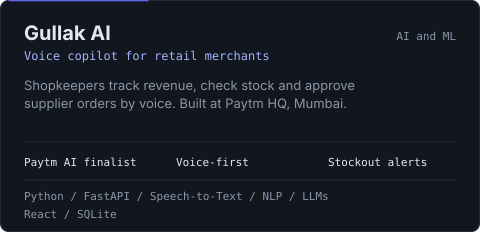
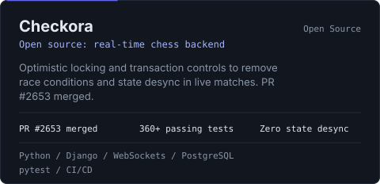
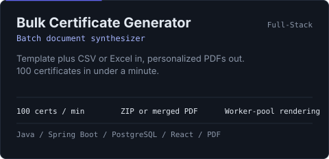

 

[Portfolio](https://rajatsurana.is-a.dev) &nbsp;/&nbsp; [Resume](https://rajatsurana.is-a.dev/resume.pdf) &nbsp;/&nbsp; [Blog](https://rajatsurana.is-a.dev/blog) &nbsp;/&nbsp; [Project API](https://rajatsurana.is-a.dev/api/projects) &nbsp;/&nbsp; [LinkedIn](https://www.linkedin.com/in/rajat-surana) &nbsp;/&nbsp; [LeetCode](https://leetcode.com/u/rajatsurana19) &nbsp;/&nbsp; [Email](mailto:suranarajat07@gmail.com)

 

I am a Computer Engineering student in Mumbai who builds backend systems and privacy-first software. I work mostly in Java with Spring Boot, and in Python with FastAPI. I care about concurrency, API security and caching, and I measure what I build. I am looking for a Software Engineer internship.

| CGPA | LeetCode | Podium finishes | Open source |
|:---|:---|:---|:---|
| 9.66 / 10 | 195+ solved | 5 top-3 placements | PR #2653 merged in Checkora |

 

  
  
  
  
  
  
  
  
  

  Source and live demos:
  <a href="https://github.com/rajatsurana19/Filevo">Filevo</a> (<a href="https://filevo.vercel.app">live</a>) &nbsp;/&nbsp;
  <a href="https://github.com/rajatsurana19/veribhoomi-ai">VeriBhoomi AI</a> (<a href="https://veribhoomi-ai.vercel.app">live</a>) &nbsp;/&nbsp;
  <a href="https://github.com/rajatsurana19/GullakAI">Gullak AI</a> (<a href="https://gullakai.vercel.app">live</a>) &nbsp;/&nbsp;
  <a href="https://github.com/Checkora/Checkora/pull/2653">Checkora PR</a> &nbsp;/&nbsp;
  <a href="https://github.com/rajatsurana19/UrlShortener">URL Shortener</a> &nbsp;/&nbsp;
  <a href="https://github.com/rajatsurana19/Certificate-Generator">Certificate Generator</a> &nbsp;/&nbsp;
  <a href="https://github.com/rajatsurana19/Multi-Linguistic-Audio-Solution">Audio Solution</a> (<a href="https://multi-linguistic-audio-solution.streamlit.app">live</a>) &nbsp;/&nbsp;
  <a href="https://github.com/rajatsurana19/UHI-Analysis-Mumbai">UHI Analysis</a>

More on the [portfolio](https://rajatsurana.is-a.dev/#projects): CivicSevak, RS-Engine (search engine and crawler from scratch), Diabetes Clinical Decision Support, CreatorStore REST Backend.

 

**Open Source Contributor, Checkora** &nbsp;|&nbsp; Nov 2026 &nbsp;|&nbsp; Remote
Fixed state desynchronization between live browser sessions and database records in a real-time chess platform. Added optimistic locking and transaction controls against race conditions on simultaneous moves. Kept CI green across 360+ backend tests. [PR #2653](https://github.com/Checkora/Checkora/pull/2653).

**Freelance Software Developer, Jewellery business client** &nbsp;|&nbsp; 2024 to 2026 &nbsp;|&nbsp; Pune and remote
Delivered three internal tools: bill and order management (200+ bills processed), OCR price-tag extraction (500+ tags scanned) and employee management. Built and launched two live client websites.

**Software Engineering Intern, Pragati Computer Academy** &nbsp;|&nbsp; Jun to Jul 2024 &nbsp;|&nbsp; Pune
Built four backend modules in Java, JDBC and MySQL. Cut average query latency by about 35% through SQL optimization. Built a Java Swing GUI.

**Backend Intern, K. J. Somaiya Institute of Technology** &nbsp;|&nbsp; 1 month
Built a URL shortener REST API with Spring Security, JWT, OAuth2 and Redis caching, reaching sub-45 ms redirects.

 

| Result | Event |
|:---|:---|
| Finalist | Paytm Build with AI Hackathon, Paytm HQ, Mumbai. Built Gullak AI. |
| Internal round winner | Smart India Hackathon internal round, 1 of 100+ teams. Built VeriBhoomi AI. |
| 1st place (2x) | Ideamine. Bharati Vidyapeeth's Jawaharlal Nehru Institute of Technology. |
| 2nd place (2x) | Symbiosis Institute of Technology. Bharati Vidyapeeth College of Engineering. |
| 3rd place | K. J. Somaiya Institute of Technology. |
| Merged PR | Checkora, open-source chess platform. Backend concurrency and state sync. |
| Certified | Cisco Networking Academy, Introduction to Cybersecurity. |
| 195+ problems | LeetCode, with focus on dynamic programming, graphs and trees. |

 

 

**B.Tech, Computer Engineering** &nbsp;|&nbsp; K. J. Somaiya Institute of Technology, Mumbai &nbsp;|&nbsp; Sep 2025 to Jun 2028 (expected) &nbsp;|&nbsp; CGPA 9.66 / 10

**Diploma, Computer Technology** &nbsp;|&nbsp; Bharati Vidyapeeth's Jawaharlal Nehru Institute of Technology, Pune &nbsp;|&nbsp; Sep 2022 to May 2025 &nbsp;|&nbsp; 94.69%

 

  
  
  
  

  

 

  <a href="https://rajatsurana.is-a.dev">rajatsurana.is-a.dev</a> &nbsp;/&nbsp;
  <a href="mailto:suranarajat07@gmail.com">suranarajat07@gmail.com</a> &nbsp;/&nbsp;
  <a href="https://www.linkedin.com/in/rajat-surana">LinkedIn</a> &nbsp;/&nbsp;
  <a href="https://leetcode.com/u/rajatsurana19">LeetCode</a>

  

