


 

  <a href="https://rajatsurana.is-a.dev">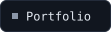</a>
  
  
  
  
  
  <a href="mailto:suranarajat07@gmail.com">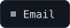</a>

 



 

  <a href="https://rajatsurana.is-a.dev/projects/filevo">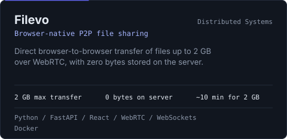</a>
  <a href="https://rajatsurana.is-a.dev/projects/mydump">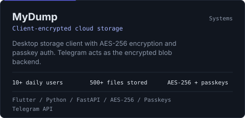</a>
  <a href="https://rajatsurana.is-a.dev/projects/veribhoomi">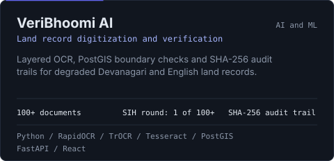</a>
  
  
  <a href="https://rajatsurana.is-a.dev/projects/url-shortener">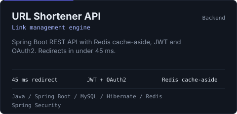</a>
  
  <a href="https://rajatsurana.is-a.dev/projects/multi-linguistic-audio-solution">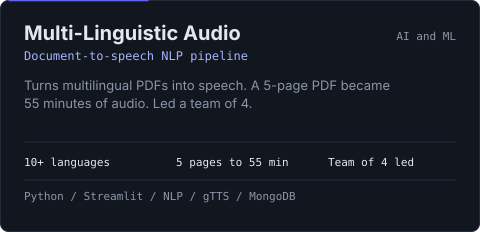</a>
  <a href="https://rajatsurana.is-a.dev/projects/uhi-analysis">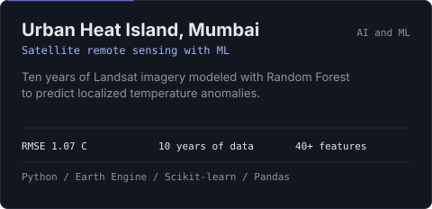</a>

  
  
  
  
  
  
  
  
  
  
  
  
  

 

 

 

 

**B.Tech, Computer Engineering** &nbsp;|&nbsp; K. J. Somaiya Institute of Technology, Mumbai &nbsp;|&nbsp; Sep 2025 to Jun 2028 (expected) &nbsp;|&nbsp; CGPA 9.66 / 10

**Diploma, Computer Technology** &nbsp;|&nbsp; Bharati Vidyapeeth's Jawaharlal Nehru Institute of Technology, Pune &nbsp;|&nbsp; Sep 2022 to May 2025 &nbsp;|&nbsp; 94.69%

 

  
  
  
  

  

 


  
  
  
  

  

